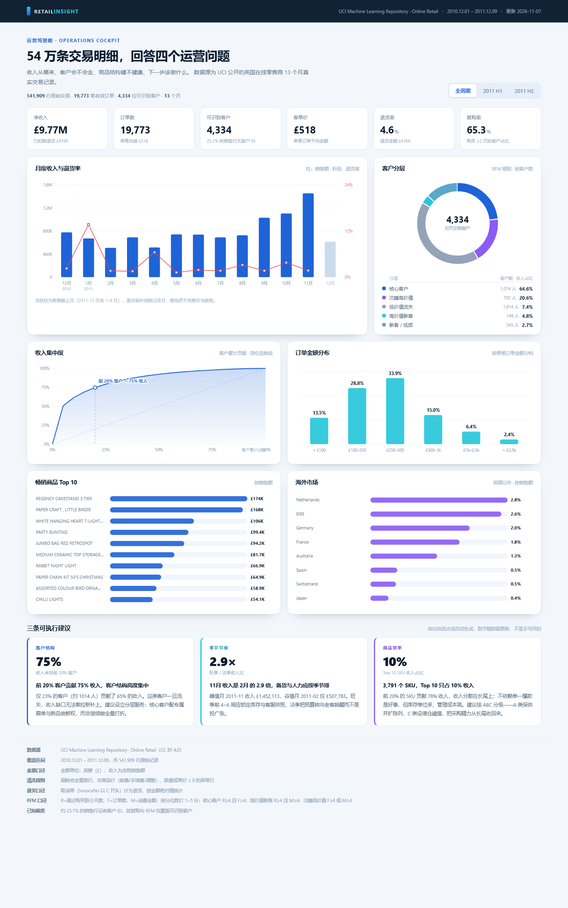

# Retail Insight — E-commerce transaction analytics dashboard

> 541,909 real transactions, four operating questions: where revenue comes from, whether customers are drifting away, how healthy the product mix is, and what to do next.

**Live dashboard**: https://nanyang182.github.io/retail-insight/



---

## What it is

| | |
|---|---|
| **Data** | [UCI Online Retail](https://archive.ics.uci.edu/dataset/352/online+retail) — 13 months of real transactions from a UK online gift retailer (2010-12 → 2011-12) |
| **Volume** | 541,909 raw rows → 522,504 valid sales lines · 19,773 orders · 4,334 identifiable customers |
| **Output 1** | A zero-dependency static dashboard (hand-written SVG, no chart library) |
| **Output 2** | A reproducible pipeline: clean → metrics → JSON → page |
| **Output 3** | A 3-page report (Word / PDF) with method and stated limits |

**Why no BI tool?** Because the point was to practise defining metrics and reconciling definitions, not dragging widgets. Hand-drawing the charts forces every number to have a traceable source.

---

## Key numbers

| Metric | Value |
|---|---|
| Gross revenue | £10.25M |
| Returns | £475.9K (4.6%) |
| Net revenue | £9.77M |
| Average order value | £518 |
| Repeat-purchase rate | 65.3% |
| Revenue from top 20% of customers | **74.6%** |
| Peak month vs trough | **2.9×** (Nov £1.45M vs Feb £508K) |
| UK share of revenue | 85.1% |
| SKUs | 3,791 — top 10 only **10%** of revenue |

---

## Quick start

```bash
pip install -r requirements.txt
python src/fetch_data.py     # first run: download ~24 MB and convert to csv.gz
python src/pipeline.py       # clean + compute metrics -> dashboard/data.js
# then open dashboard/index.html
```

Or just double-click `dashboard/index.html` — the generated data is already committed.

---

## Pipeline rules (all in code)

- Drop 5,268 fully duplicated rows.
- Remove non-product lines (postage, manual adjustments, bad debt); keep 5-digit stock codes only.
- Cancellations (`InvoiceNo` starting with `C`) are counted as returns by absolute amount and excluded from sales.
- 25.1% of sales lines have no customer ID, so RFM and repeat rate only cover ~75% of transaction value — stated in the report.

---

## Known limits

1. No cost data → revenue structure only, no margin analysis.
2. 25% of orders are anonymous → customer metrics are biased upward.
3. 2011-12 covers 9 days only → marked as a partial month in the trend chart.
4. Single merchant, single country, 13 months → seasonality does not generalise.
5. Correlation only, no causality.

---

## Layout

```
retail-insight/
├─ dashboard/       index.html, styles.css, app.js (hand-written SVG), data.js
├─ src/             fetch_data.py, pipeline.py, build_report.py
├─ data/raw/        online_retail.csv.gz (not committed; fetched by script)
├─ docs/            report (.md / .docx / .pdf), screenshots
└─ requirements.txt
```

---

## Related projects

- **JD Lens** (frontend / product) → [nanyang182/jd-lens](https://github.com/nanyang182/jd-lens)
- **SplitLink** (backend) → [nanyang182/splitlink](https://github.com/nanyang182/splitlink)
