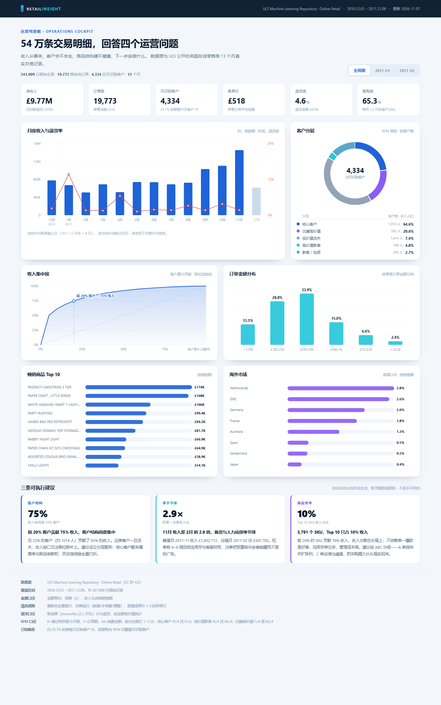

# Retail Insight · 电商交易洞察看板

> 用 54 万条真实交易明细，回答四个运营问题：收入从哪来、客户会不会走、商品结构健不健康、下一步该做什么。



---

## 一、这是什么

| | |
|---|---|
| **数据源** | [UCI Online Retail](https://archive.ics.uci.edu/dataset/352/online+retail)，英国在线礼品零售商 2010-12-01 ~ 2011-12-09 的真实交易流水 |
| **数据量** | 541,909 行原始记录 → 522,504 行有效销售明细 · 19,773 笔订单 · 4,334 位可识别客户 |
| **产出 1** | 一个零依赖的静态看板（原生 SVG，不引 ECharts / Chart.js） |
| **产出 2** | 一套可复跑的指标流水线（清洗 → 指标 → JSON → 页面） |
| **特点** | 双击 `index.html` 就能演示，不需要服务器、不需要联网 |

**为什么不用现成的 BI 工具？** 因为要练的是"指标怎么定义、口径怎么统一、结论怎么从数据里长出来"，而不是拖控件。图表手写反而逼着把每个数字的来源讲清楚。

---

## 二、快速开始

### 只想看效果

双击 `dashboard/index.html`。就这样，不需要装任何东西。

### 想改数据、重跑一遍

```bash
pip install -r requirements.txt
python src/fetch_data.py     # 首次运行：下载公开数据（约 24 MB，转成 csv.gz）
python src/pipeline.py       # 清洗 + 算指标 → 重新生成 dashboard/data.js
# 然后刷新浏览器
```

Windows 用户也可以直接双击 `run.bat`。

> 如果你的 Python 装不上 pandas，可以先只看看板——`data.js` 已经是生成好的。

---

## 三、目录结构

```
retail-insight/
├─ dashboard/
│  ├─ index.html        页面骨架
│  ├─ styles.css        设计系统（配色与生涯展示 PPT 一致）
│  ├─ app.js            图表渲染（手写 SVG，约 500 行）
│  └─ data.js           由 pipeline 生成的数据快照（含 3 个时间切片）
├─ data/raw/
│  └─ online_retail.csv.gz
├─ src/
│  ├─ fetch_data.py     下载 + 格式转换
│  ├─ pipeline.py       清洗规则、指标口径、结论生成
│  └─ build_report.py   生成 Word 版项目报告
├─ docs/
│  ├─ Retail_Insight_项目报告.docx   可直接提交的 A4 报告（3 页）
│  ├─ Retail_Insight_项目报告.pdf    同上的 PDF 版本
│  ├─ 项目报告.md        报告的可编辑 Markdown 源
│  └─ shots/            截图
├─ requirements.txt
└─ run.bat
```

### 三份可直接用的交付物

| 用途 | 文件 |
|---|---|
| 现场演示 | `dashboard/index.html` |
| 提交给导师 / 评委 | `docs/Retail_Insight_项目报告.pdf`（或 .docx） |
| 讲 3 分钟的口播稿 | `docs/项目报告.md` 第六节 |

---

## 四、指标口径（全部写在代码里）

| 指标 | 定义 | 备注 |
|---|---|---|
| 净收入 | 有效销售额 − 退货金额 | 有效销售 = 非取消单、数量 > 0、单价 > 0、商品编码合法 |
| 订单数 | 有效销售中去重后的 InvoiceNo 数量 | 同一发票多行商品算 1 笔 |
| 可识别客户 | 去重后的 CustomerID | 约 25% 的销售行没有客户 ID |
| 客单价 | 有效销售额 ÷ 订单数 | 批发场景，均值会被大单拉高 |
| 退货率 | 退货金额 ÷ 有效销售额 | 取消单（InvoiceNo 以 `C` 开头）计为退货 |
| 复购率 | 订单数 ≥ 2 的客户 ÷ 可识别客户 | 只看有 ID 的客户，会高估 |
| RFM | R = 距今天数（反向打分）、F = 订单数、M = 消费额，各按分位数打 1–5 分 | 分层规则见 `pipeline.py` |
| 洛伦兹曲线 | 客户按消费额降序，累计人数 vs 累计收入 | 用于看收入集中度 |

### 清洗规则（逐条可解释）

1. 删除 5,268 行完全重复记录；
2. 剔除 `POST`、`DOT`、`M`、`BANK CHARGES` 等非商品行（邮费、手工调整、坏账），只保留 5 位数字（可带字母后缀）的商品编码；
3. 剔除数量 ≤ 0 且非取消单的异常行；
4. 剔除单价 ≤ 0 的行（赠品、内部调拨）；
5. 取消单单独归为「退货」，按金额绝对值统计，不参与销售额。

---

## 五、已知偏差与取舍（答辩会被问）

- **25.1% 的销售行没有客户 ID**：这批多为散客/线下单，无法做 RFM，所以复购率与客户分层实际只覆盖 75% 的交易额，结论要打个折扣说。
- **2011-12 只有 1–9 日**：最后一个月不完整，趋势图用浅色柱标出，退货率折线跳过该月，避免把"截断"当成"下滑"。
- **只有收入、没有成本**：算不出毛利，所以所有建议都基于"收入结构"而非"利润结构"，这是这份分析的边界。
- **单商家、单国家、13 个月**：季节性结论（旺季 2.9 倍）来自一家英国批发商，不能直接套到别的品类。
- **退货率的分母**：用销售额而非订单数，大额退货单会放大比率，看趋势可以，看绝对值要谨慎。

---

## 六、换一份数据要改哪里

1. 把新数据整理成同样的 8 列（InvoiceNo / StockCode / Description / Quantity / InvoiceDate / UnitPrice / CustomerID / Country），存成 `data/raw/online_retail.csv.gz`；
2. 若列名不同，改 `pipeline.py` 里的 `load_raw()`；
3. 改 `PERIODS` 里的时间切片；
4. 重跑 `python src/pipeline.py`。

结论文字是 f-string 拼出来的，换数据后数字会自动变，不会出现"图变了文字没变"的假报告。

---

## 七、这个项目里可以讲的东西

- **指标定义能力**：净收入、退货率、复购率的口径都能一句话说清，并且知道每个口径会在哪里失真。
- **数据清洗**：5,268 行重复、9,288 张取消单、2,517 行零单价——先处理脏数据再谈洞察。
- **产品思维**：不是"画了 6 张图"，而是"用 6 张图支撑 3 条可执行建议"，每条建议都带影响面和度量方式。
- **工程取舍**：为什么手写 SVG 而不用图表库——离线可演示、体积极小、样式可控。
- **诚实**：已知偏差单独列一节，主动说清楚数据能支撑什么、不能支撑什么。
